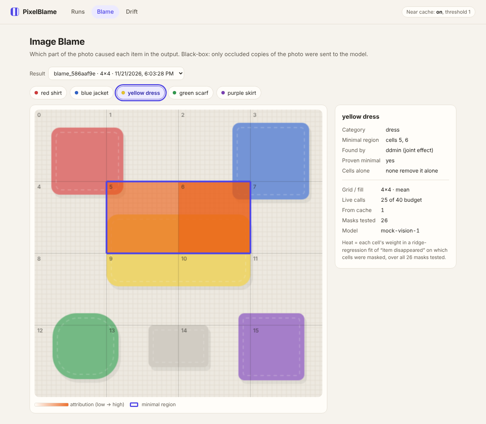
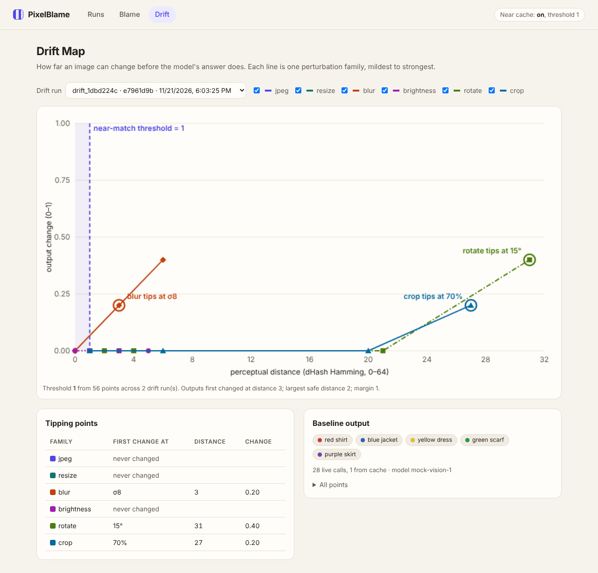
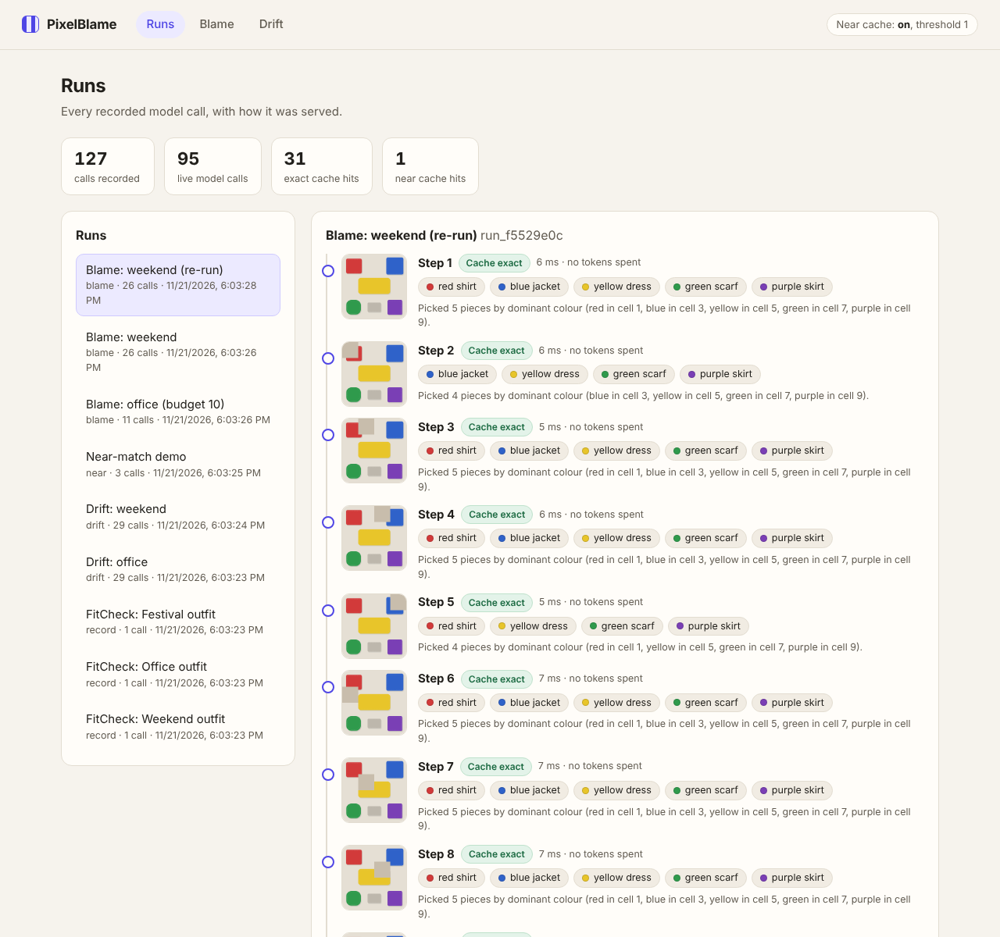
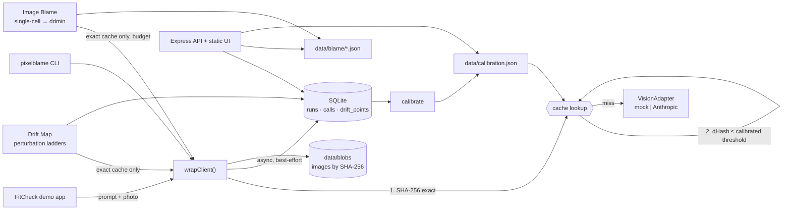

# PixelBlame

**Debugging tools for apps that send images + text to a vision-language model.**

When a vision model returns the wrong JSON, two questions are hard to answer from logs alone:

1. **Which part of the photo caused this item?** → **Image Blame**: black-box occlusion over a grid, then delta debugging (ddmin) to find a *minimal* set of regions whose removal makes an output item disappear.
2. **How much can the image change before the answer changes, and can I safely reuse cached answers for similar images?** → **Drift Map** + a **calibrated near-match cache**: measure output change against perceptual distance, then let *that measurement* set the cache's similarity threshold.

Basic record/replay of LLM calls is a commodity, and PixelBlame keeps that part minimal on purpose.



| Drift Map | Runs |
|---|---|
|  |  |

*(Screenshots are from the offline demo with the mock vision adapter.)*

## Quick start

Requires Node 20+.

```bash
npm install
npm run demo:all      # record FitCheck scenarios, Drift Map + calibration, near-match demo, Image Blame
npm run dev           # UI at http://localhost:4317
```

No API key needed: a deterministic **mock vision adapter** is used unless `ANTHROPIC_API_KEY` is set (see `.env.example`).

Individual demos: `npm run demo`, `npm run demo:drift`, `npm run demo:near`, `npm run demo:blame`. Tests: `npm test`.

## CLI

```bash
npm run build
alias pixelblame="node packages/core/dist/cli.js"

pixelblame record                                   # run FitCheck scenarios, record each call
pixelblame runs                                     # list runs
pixelblame replay <runId>                           # replay from recordings; adapter never called
pixelblame drift <runId|image> --family jpeg,blur   # Drift Map (all six families by default)
pixelblame calibrate [--margin 1]                   # writes data/calibration.json
pixelblame blame <image> --grid 4 --max-calls 40 --dry-run
pixelblame blame fitcheck:weekend                   # fitcheck:<weekend|office|festival> = generated demo photo
```

## Architecture



Packages (npm workspaces): `core` (library + CLI), `server` (REST API + vanilla JS UI), `demo` (narrated demo scripts).

## How it works

### Recorder and cache (kept minimal)

`wrapClient(adapter, { store })` wraps any `VisionAdapter`. Each call stores the prompt, params, response JSON, latency and tokens. Images are stored once by SHA-256 in `data/blobs` along with their dHash. Writes go through an async queue, and a failing write is reported to `onError` but never breaks the call. A test checks this with a store that throws on every write.

Cache lookup order:
1. **Exact**: SHA-256 of the image bytes plus a hash of model, prompt and params.
2. **Near**: same model, prompt and params, with every image's dHash within the **calibrated** threshold. With no calibration, near matching is **off**.

Every hit is labeled: `exact`, or `near` with its distance and the threshold that allowed it. The UI shows these as badges.

### Item-level diff

Outputs are compared as sets of items keyed by normalized name. The diff reports added, removed, changed (category/color) and reordered items. Change score = `1 − weighted Jaccard`: a changed item counts as half a match, and reordering adds a 0.05 penalty. The score is clamped to [0, 1]. It's a pure function with unit tests.

### Drift Map

The same request is replayed with six perturbation ladders, mildest to strongest:

| family | steps |
|---|---|
| JPEG quality | 90, 70, 50, 30 |
| downscale | 90, 70, 50, 30 % |
| gaussian blur | σ 0.5, 1, 2, 4, 8, 16 |
| brightness | ±10, ±20, ±30 % |
| rotation | 2, 5, 10, 15° (cropped back to the original size) |
| center crop | 95, 90, 80, 70 % |

For each step it records the **perceptual distance** (Hamming distance between 64-bit dHashes, 0–64) and the **output change** (the diff score). The **tipping point** of a family is the first step whose output differs. Drift runs use the **exact cache only**: a near-match cache would answer with the baseline and hide the very drift you are measuring.

### Calibration

`calibrate` reads the drift points and computes:

- `firstChange` = the smallest distance at which any output changed
- `safeMax` = the largest observed distance below `firstChange` (every observation at or below it was unchanged)
- `threshold = safeMax − margin` (margin defaults to 1); if that is negative, or there is no data, near matching stays **off**

Calibration records the models and request keys it measured, and the near cache only applies to those.

### Image Blame

1. **Baseline**: one call with the unmodified (re-encoded) photo.
2. **Single-cell occlusion**: each N×N cell is filled with the image's mean color (or a blur, with `--fill blur`). If an item disappears, that cell alone explains it.
3. **ddmin**: for items no single cell explains, Zeller's delta debugging over all cells, with test = "item absent when these cells are masked". It returns a **1-minimal** set: un-masking any one of its cells brings the item back. This catches joint effects, e.g. a garment that straddles two cells.
4. **Heatmap**: ridge regression of "item lost" on "cell masked" over **every** mask tested (LIME-style). A plain conditional average blamed cells that were only ever masked *together* with the real cause. Regression separates them.

Every mask goes through the **exact** cache, so masks shared between items, and full re-runs, cost nothing. Near matching is deliberately disabled here. Across the three demo photos, 14 single-cell masks removed an item; **6 of them were within dHash distance 1** of the unmasked photo and 2 were at distance 0. Even a threshold of 1 would have silently answered "nothing changed" for those masks. `--max-calls` (default 40) is a hard budget on live calls. When it runs out, cached masks are still used, and items that weren't resolved are marked "not proven minimal". `--dry-run` prints the estimated calls and cost first.

### Mock vision adapter

Deterministic, no network. It splits the image into a 3×3 grid, finds each cell's dominant hue among saturated pixels (HSV saturation ≥ 0.5, at least 35% of the cell), and maps hue buckets to garments (red → "red shirt", blue → "blue jacket", …). It returns unique items in cell order. So occluding a cell removes its item, heavy blur washes out saturation, rotation and crop move color across cell borders, and mild JPEG or resize changes nothing. The demo photos are generated flat-lays (sharp + SVG).

## Measured results (offline demo, mock adapter)

From `npm run demo:all` on a clean `data/`:

- **Calibration**: 56 drift points from two photos → threshold **1** (outputs first changed at distance 3, from a σ8 blur).
- **Near hit**: the same photo re-saved at 60% size as JPEG q60 (14,692 → 6,620 bytes, different SHA-256) was served from cache at **distance 1**.
- **Correct rejection**: a σ24 blur (distance 9) was **not** served from cache. Its real output dropped 3 of 5 items (change score 0.6), so reusing the cached answer would have been wrong.
- **Image Blame** (4×4, 5 items): **25 live calls** within the 40-call budget. Four items were explained by one cell each. The yellow dress needed the joint pair of cells [5, 6], which no single-cell test reveals; ddmin found it in 8 additional calls. A full re-run took **0 live calls (26/26 from cache)**.
- **Budget guard**: with `--max-calls 10`, blame stopped at exactly 10 live calls and marked 2 items as unresolved.
- **Overall**: 127 calls recorded, 95 live and 32 served from cache (25%).
- **Reference cost**: the dry-run estimates the weekend blame at ~$0.10 on a $3/$15-per-MTok model (~525 tokens per call). Real image token counts depend on the provider.

## How this differs from existing tools

- **Record/replay is a commodity.** VCR-style HTTP recorders and LLM observability/gateway products already record calls and cache responses. PixelBlame's recorder is intentionally minimal.
- **Exact-byte cache matching is the common approach**, including provider-side prompt caching, which keys on exact content.
- **Near-duplicate caching itself is not new.** Text semantic caches (e.g. GPTCache) match by embedding similarity, and there are image caches that use perceptual hashes (for example, an MCP server that caches UI screenshots with dHash/aHash). What I did not find in my searches is a cache whose similarity threshold is **derived from measured output drift** for a specific model and prompt, that stays **off** until calibrated, and that labels every near hit with its distance and threshold.
- **Black-box attribution for VLMs exists in research**: occlusion (Zeiler & Fergus), RISE, LIME, and VLM-specific work such as PixelSHAP and Eagle. I did not find a developer tool that attributes **individual items of a structured JSON output** to image regions, uses **ddmin to find a minimal joint region**, and runs under a hard call budget with a shared cache.

These are claims about what I found, not claims of being first.

## Limitations (honest)

- **The occlusion fill can itself influence the model.** A mean-color patch is still content: a real model might "see" a gray garment, or behave differently on an unnatural image. Blame reports masks where the fill introduced new items (`fillArtifacts`), and `--fill blur` gives a second opinion.
- **dHash is weak against crops and rotations** (a 10° rotation is already at distance ~20). It's also nearly **blind to blur**: on the festival photo, a σ8 blur changed the output at distance **0**. Calibrating on all three photos therefore turns near matching **off**, which is the correct, conservative outcome. The demo calibrates on two photos and says so.
- **Calibration is only valid for the models and prompts it was measured on**, and only for perturbations like the ones in the ladders. It's enforced per model and request key, but it can't anticipate edits that dHash can't see.
- **Mock results are not real model behavior.** The mock makes both features demonstrable offline. Real VLMs are noisier: at temperature > 0, the same image can produce different outputs, which would show up as "drift at distance 0" and switch the near cache off.
- Grid cells don't align with objects; a coarse grid can miss small causes, and a fine grid costs N² + ddmin calls.
- ddmin finds *a* 1-minimal set, not necessarily the globally smallest one.
- The Anthropic adapter is implemented, but in this build it was only exercised offline (unit-tested JSON extraction). The default model string and pricing are configurable placeholders.

## Future work

- Object-aware masks (segmentation) instead of a fixed grid; adaptive grid refinement around hot cells.
- A stronger perceptual signal for calibration (pHash or a small embedding model) alongside dHash.
- Per-family calibration, e.g. ignore near hits whose distance profile looks like a crop.
- Repeated sampling to separate model nondeterminism from real drift.
- OpenAI and Gemini adapters.

## License

MIT
